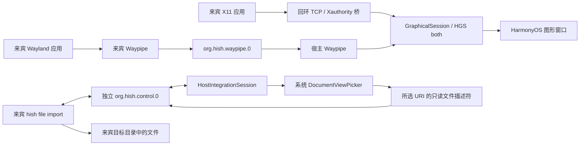

# HiSH 图形窗口与宿主文件导入：实施路线和 Agent 交接

更新日期：2026-11-16。本文是后续实施计划；除“当前基线”外，描述的新增能力尚未实现。

目标是在现有 HGS 接入上完成 X11 / Wayland 共存，提供适合高分辨率设备的窗口缩放，并允许用户从 Linux 命令行调用 HarmonyOS 文件选择器，将所选文件复制到虚拟机内。随后完善多应用、剪贴板、输入法和性能。

用户当前要求先规划、交接，并暂缓此前讨论的运行验证。本次只阅读代码和编写文档，没有构建、签名、安装或真机测试。以下验收项是后续工作的完成条件，不代表已经通过；接手者应继续遵守这一验证暂停状态，直到用户调整安排。可以完成代码工作并明确标注待验证，不能把“代码完成”记为“验收通过”。

## 1. 当前基线

| 项目 | 交接时状态 |
| --- | --- |
| 主仓库 | `/workspace/HiSH`，分支 `feature/using-hgs` |
| 主仓库 HEAD | `e1e6d3c`，在平板设置中启用 Wayland 窗口实验 |
| HGS 子模块 | `/workspace/HiSH/hgs`，提交 `77e7cd1b10db72c312d6d09bd8c541e083957153` |
| HGS 工作分支 | 当前本地为 `feature/x11-window-ability`；复现以主仓库记录的子模块提交为准 |
| 主要目标设备 | 当前以 ARM64 HarmonyOS 平板、默认 Alpine 来宾为已工作的基础 |
| X11 | HGS + Xwayland，来宾通过 `10.0.2.2` 访问宿主回环 TCP 桥，使用 Xauthority；已有设置开关和 `/run/hish-gui` |
| Wayland | 来宾 Waypipe → 专用 virtio-serial → 宿主 Waypipe 原生子进程 → HGS；已有设置开关和 `/run/hish-wayland` |
| 双开关行为 | 普通启动优先 Wayland，宿主 Wayland 启动失败时尝试 X11；尚未接通两者同时服务 |
| Wayland 并发 | 可顺序启动多次应用；同一时间仍只有一个应用连接，不能等同于多个独立 Waypipe 会话并发 |
| 系统文件选择器 | 共享文件夹页面已有单文件选择、复制到宿主共享目录的能力，来宾通常在 `/mnt/share` 访问 |
| 窗口缩放 | HGS 已有 `windowScale`，HiSH 尚无对应设置；不能据此认定两种协议的完整缩放行为已经验收 |

历史验证记录见 [X11 接入记录](hgs-x11-p0.md) 和 [Wayland 接入记录](hgs-wayland-p3.md)。其中已记录 X11 建窗、键鼠、模态窗口，以及 Wayland GTK 共享内存显示、键鼠、连续关闭再启动。历史结果不覆盖本文的新功能。

当前 X11 独立 Ability 窗口仍由 `hish.x11.toplevel` 调试参数控制，普通路径保留子窗口行为。接通双协议时应保留这两种承载方式，不能顺便把调试路径变成所有设备的默认行为。

## 2. 优先级和依赖

建议按下面顺序实施。新增的缩放和文件导入先于多 Wayland 应用、剪贴板和输入法交付。

| 阶段 | 交付内容 | 依赖 | 完成后用户获得什么 |
| --- | --- | --- | --- |
| G1 | 统一图形会话，接通 `protocols: 'both'` | 当前基线 | 同一虚拟机同时运行 X11 和 Wayland 应用 |
| G2 | 完善启动降级、局部失败、退出和旧回调隔离 | G1 | 一路故障不会被 HiSH 错误扩大到整个会话 |
| S1 | 设置中的统一窗口缩放 | G1、G2 | 选择比例后重启 HiSH，图形窗口和内容按该比例显示 |
| F1 | 独立宿主控制通道、来宾 `hish` 命令与自动部署 | G1、G2 的 VM 生命周期约定 | 来宾可以可靠地请求宿主能力，图形关闭时也能工作 |
| F2 | `hish file import` 的选择、传输和落盘 | F1 | 运行命令、系统选文件、文件出现在来宾目标目录 |
| W1 | 多个独立 Wayland 应用连接并发 | G1、G2；采用本文槽位分配方案时还依赖 F1 | 一次启动多个 Wayland 应用且能分别退出 |
| D1 | 焦点、剪贴板、中文输入法 | G1、G2、S1；跨应用矩阵依赖 W1 | 完整的日常桌面交互 |
| A1 | 性能、GPU、音频 | 前述功能稳定后分别立项 | 更重的图形应用和多媒体支持 |

S1 和 F1/F2 的业务逻辑可以独立开发，但都会触及启动入口。多人接手时先确定 G1/G2 的接口；同一分支上的 `EntryAbility.ets`、`startVm.ets` 和 HGS 子模块指针由集成人统一处理。

S2（已有窗口动态缩放）、普通用户命令接入、多文件导入、文件导出均为后续增量，不纳入首版完成条件。首版不要求一次实现整份路线。

## 3. 总体结构和所有权

建议新增一个小型 `GraphicalSession` 协调器，集中持有 HGS 会话、图形运行目录和本轮 epoch。`X11Session`、`WaypipeSession` 分别负责自己的桥接、传输和来宾配置。不要让两者各自启动、停止同一个进程级 HGS 单例。

文件导入属于 HiSH 的宿主交互服务，由 VM 生命周期管理，独立于 HGS 和 Waypipe 的开关。



需要区分三个标识：VM 会话 generation、HGS epoch、单个控制请求 ID。VM 重启后即使配置中的 emulator ID 不变，也必须生成新的 generation；所有异步任务在写状态或使用资源前校验所属会话。不能仅用 `stageActive` 或“当前存在 VM”判断旧任务仍有效。

启动顺序应为：读取设置与能力 → 准备本轮目录和宿主监听 → 确定 QEMU 参数 → 启动 VM → 串行发布来宾工具 → 各服务分别进入 ready。退出时先使 generation 失效，再停止接收请求、撤销订阅、关闭桥和子进程、停止 HGS；QEMU 不再使用资源后才删除目录。

## 4. G1：X11 与 Wayland 同时运行

### 4.1 代码基础

`HgsServiceOptions.protocols` 已支持 `wayland`、`x11`、`both`。`HgsWindowHostService.startService()` 可以同时接入 Wayland Ability 和 X11 窗口 host，无需为了双协议复制两套 HGS 实例。

目前 `EntryAbility.ets` 根据是否获得 Waypipe socket 决定只走其中一路。`WaypipeSession` 和 `X11Session` 都调用 `HgsWindowHostService.init/startService/stopService`，这是先要解除的所有权冲突。

### 4.2 实施要求

1. 将 X11 资源准备从私有 `prepareX11()` 提取为可复用函数。协调器只初始化一次 window host，同时传入 Wayland Ability、可选 X11 Ability 和缩放配置。
2. 根据开关与构建能力选择 `none / x11 / wayland / both`。两项都关闭时，终端和 VM 正常启动；一项未编入时不应影响另一项。
3. 把 X11 桥接和来宾发布改为可附着已有 `HgsSession`。Waypipe 也附着协调器持有的 Wayland endpoint，不能在自己的异常处理中直接停止共享 HGS。
4. Waypipe 宿主 socket 必须在 QEMU 启动前准备好。来宾 X11 环境和 Wayland launcher 必须在 VM 启动后发布。
5. 来宾发布先串行执行、分别处理结果。`QemuAgentManager.acquire()` 的空闲分支存在异步建连窗口，不应直接把两个发布任务放进 `Promise.all`；必要时单独修正管理器的获取互斥。
6. 保持 `/run/hish-gui`、`/run/hish-wayland` 的现有用法。明确清理另一协议的环境变量，避免工具包自行选错后端。
7. 设置页保留各自状态，移除“两项开启时 X11 仅作回退”的描述。区分“宿主 endpoint 就绪”和“来宾命令已发布”，后者完成才显示用户可用。
8. 保留诊断 Want 参数，并写清单独强制一路及显式同时指定时的规则。普通设置中的双开启必须进入 both。

### 4.3 验收

- 四种开关组合均启动成功；both 下一个 X11 应用和一个 Wayland 应用同时可见、可输入、可分别关闭。
- 关闭图形窗口不关闭 VM，关闭 VM 回收两路窗口与监听。
- `/run/hish-gui run`、`/run/hish-wayland run` 不交叉污染环境；原有 Xauthority 拒绝无认证连接的行为保留。
- X11 子窗口与独立 Ability 两种路径都在后续验证矩阵中覆盖。

## 5. G2：故障隔离与生命周期

当前 HGS 在 both **启动过程中**任一路失败会回滚已启动的后端，见 `hgs/src/main/cpp/runtime/service_runtime.cpp`。运行中 backend-disconnected 则会移除该 endpoint，只有 endpoint 全部消失才把运行状态标记为 failed。两种情况不能采用相同处理。

### 5.1 启动降级

- both 启动失败后，依据错误来源，在用户启用的协议中执行有限次单协议重试。X11 资源失败可直接尝试 Wayland；Wayland / Waypipe 准备失败可尝试 X11。不能无限重启。
- 降级在 VM 启动前尽量完成，确保 QEMU 只引用仍有效的 socket 和目录。
- 来宾启动后某个 launcher 发布失败，只标记该路失败，不重启 VM 或摧毁另一条健康连接。
- 所有图形服务失败也应保留可用的 Linux 终端，并显示具体失败阶段。

### 5.2 运行与停止

- X11 的事件过滤必须同时检查 epoch 和 `origin === 'xwayland'`。当前 `X11Session` 对任意 backend-disconnected 都停止整个服务的处理需要修改。
- Waypipe 退出只处理对应传输和连接。正常应用退出与传输崩溃必须区别记录。
- 停止操作要幂等，覆盖启动中退出、QGA 正在发布时关机、Ability 已销毁后 picker / 子进程迟到回调等情况。
- 不默认承诺无损热重启一个 HGS backend：现有运行时配置变更可能要求整体 stop/start。第一版允许保留健康一路、故障一路提示重启 HiSH；更细粒度恢复需另做 HGS 设计。
- 记录服务名、VM generation、HGS epoch、失败阶段和错误码；避免把文件内容、认证 cookie 或 picker 完整 URI 写入公开日志。

### 5.3 验收

覆盖 X11 资源缺失、Waypipe 不可用、QGA 超时、Xwayland 退出、来宾启动命令失败、启动途中退出、连续启动/退出。检查健康一路、终端与 VM 的存活情况，以及残留窗口、监听、fd、子进程和运行目录。

## 6. S1：设置中的窗口缩放

### 6.1 首版产品行为

- 入口：设置 → Linux 应用窗口 → 窗口缩放。
- 提供 `100% / 125% / 150% / 175% / 200% / 250% / 300%`；默认 `100%`，保持现有安装的显示行为；提供恢复默认。
- 同一个比例作用于 X11 和 Wayland 的图形内容，不改变 HiSH 终端字体大小、VNC 缩放和系统标题栏字体。
- S1 保存设置后提示“重启 HiSH 后生效”。整轮图形会话读取同一个比例快照，防止同一窗口树混用新旧倍率。
- 偏好值建议命名 `guiWindowScale`，使用有限数值并校验范围或允许值；缺失、NaN、零、负数和损坏数据回退到 `1.0`。
- 首版使用明确比例。自动跟随屏幕密度、外接屏独立配置和已有窗口实时缩放留给 S2，避免对“100%”的含义产生歧义。

### 6.2 比例的技术定义

`S` 表示“来宾内容逻辑像素 → 宿主内容物理像素”的倍率。例如来宾内容为 `800 × 600`，在可用空间足够时，200% 对应 `1600 × 1200` 的宿主内容区域。OHOS 装饰栏单独计量，不参与内容倍率相乘。

几何、绘制、输入必须共享同一变换：

```text
宿主内容尺寸 = 来宾内容逻辑尺寸 × S
来宾输入坐标 = (宿主内容坐标 − 实际绘制偏移) ÷ 实际绘制倍率
宿主调整尺寸后下发的来宾内容尺寸 = 宿主内容尺寸 ÷ S
```

这是约束，不是要求新增第二套坐标转换。X11 的 `HgsWindowSurface` 已发送归一化输入，Wayland native 输入已有渲染变换反算；优先沿用并补齐现有路径，避免再次除以 S。窗口受到系统最小尺寸、可用区域、letterbox 限制时，输入必须以最终绘制矩形为准。

### 6.3 可复用点和真实边界

- `HgsWindowHostOptions.windowScale` 已存在，协调器初始化时应统一传入。
- Wayland `WindowRecord.scale` 在建窗时保存比例，`HgsAppWindowAbility` 预显示 resize 使用它。
- X11 `HgsServiceWindowHost` 构造时取得比例，布局按屏幕限制缩放，并在宿主 resize 回传时除以 `entry.scale`。
- `setWaylandWindowScale()` 只影响后续 Wayland 窗口；它不会更新已建立的窗口，也不会同步 X11 host。仅把设置绑定到这个函数不构成 S1 的完整实现。
- `setDisplayScale()` 当前是 no-op；`HgsConfig.output.scale` 不能当作可用的通用缩放开关。
- 当前 Wayland `wl_output.scale` 固定为 1，`surface_set_buffer_scale` 为空实现。S1 定义为宿主呈现缩放，可能有位图放大的模糊；不要宣称已实现客户端按 HiDPI 重绘。分数缩放协议、buffer scale 和工具包 DPI 协同另行规划。
- 不通过全局设置 `GDK_SCALE` / `QT_SCALE_FACTOR` 实现 S1，否则容易与宿主倍率重复放大，也不能覆盖所有 X11 应用。

### 6.4 改动范围

1. `appOption.ets`、`EntryAbility.ets`：偏好定义、读取、校验和本轮快照。
2. `SettingsContent.ets`、base / zh_CN 字符串资源：选择控件、当前比例、重启提示。
3. G1 协调器：在所有单协议、双协议、降级路径传入相同比例。
4. 审查 HGS 的顶层尺寸、菜单/弹窗锚点、模态居中、最大化/恢复、内容尺寸回传和输入变换。若现有能力已满足，保持 HGS 不变；若必须修补，作为独立子模块提交，不把通用缩放逻辑写到 HiSH 包装页。

正常态显示不了完整窗口时应限制在可用区域，保留操作入口；最大化应占可用区域，恢复回原正常态。避免客户端 configure 与宿主 resize 相互乘倍率，造成窗口持续增大或缩小。

### 6.5 验收

- 100%、150%、200%、300% 分别覆盖 X11 / Wayland、普通/最大化/恢复、菜单和模态对话框。
- 不只观察外框：文字和按钮的实际显示大小变化，按钮中心与四角点击位置正确，拖动/滚动/键盘工作。
- 修改后重启仍保持比例；启动降级后倍率不丢失；缩放不改变终端字号。
- 超大窗口、系统最小尺寸和可用区域限制下，窗口可操作且输入不漂移；无 resize 反馈环。
- 记录客体逻辑尺寸、目标宿主尺寸与实际 window rect，区分系统约束和实现错误。

## 7. F1/F2：来宾命令调用系统 picker 并导入文件

### 7.1 命令约定

建议统一使用来宾命令 `hish`，首版提供以下接口：

```sh
hish status
hish file import
hish file import --to "$HOME/Downloads"
hish file import --to ./assets --name picture.png
hish file import --to ./assets --name picture.png --force
hish file import --json
```

- 默认导入到执行命令时的当前目录。`--to` 表示已存在的来宾目录，不在宿主解释这个路径。
- 默认保留所选文件名；`--name` 只接受非空的单个文件名，不能包含目录分隔符或 NUL，也不能等于 `.` 或 `..`。
- 默认不覆盖同名文件，返回明确错误；`--force` 才允许替换普通文件，拒绝目录和符号链接目标。
- 命令等待选取、传输和最终落盘结束。成功后 stdout 输出最终来宾绝对路径；进度和提示写 stderr。`--json` 输出单个结构化结果，以便脚本处理含换行等特殊字符的路径。
- 单次只选一个普通文件；空文件有效。取消选取不创建目标文件，不当作成功。
- 首版面向当前默认镜像的 root 终端。普通用户直接访问 virtio 设备的权限并未解决，应返回明确提示；不默认采用 setuid 或把设备权限放开到所有用户。后续可增加经过授权的来宾代理。
- `hish status` 显示协议版本、宿主连接、file-import 能力；图形状态仅在确有查询接口时添加。

建议固定退出码：`0` 成功、`1` I/O 或内部错误、`2` 参数错误、`3` 用户取消、`4` 服务不可用/权限不足、`5` 目标冲突、`6` 超时、`7` 忙、`130` Ctrl-C。对外发布后保持兼容。

### 7.2 传输选择

推荐增加独立 virtio-serial 控制端口 `org.hish.control.0`，使用现有 `virtio-serial0` 控制器。宿主在应用私有运行目录创建短路径 Unix socket，QEMU 连接它；宿主服务在 VM 启动前就绪。

选择理由：该功能需要来宾主动请求宿主 UI。QGA 当前主要用于宿主主动执行来宾命令，可以负责安装工具，但不适合作为来宾反向 UI 请求通道。控制请求和文件数据也不应插入 Waypipe 字节流或通过终端转义序列承载。

首版直接在独立控制流中传输文件内容，按块处理并施加背压。这样无需用户先进入共享文件夹、无需来宾额外挂载，也不受 `/mnt/share` 只读偏好影响。现有共享文件夹 import UI 继续服务其原有用途。

不为首版额外开放 TCP/HTTP 端口。文件导入不依赖 HGS、Waypipe 构建开关或两项图形设置。

控制服务准备或来宾工具安装失败时，VM 和终端仍应启动，文件导入能力报告不可用。以平板作为首个验收设备，但文件服务本身不硬编码 tablet 限制；phone / 2in1 根据实际 picker 和构建能力启用，分别补充设备验收。

### 7.3 服务划分

| 组件 | 建议位置 | 职责 |
| --- | --- | --- |
| `HostIntegrationSession` | `feature/hish_main/src/main/ets/service/` | 与 VM 绑定的启动/停止、能力和 UI 请求协调 |
| `HostFileImportService` | 同上 | 在有效 UIAbilityContext 上调用 picker，打开 URI，管理选取取消与文件读取生命周期 |
| Native control bridge | `feature/hish_main/src/main/cpp/host_integration/`（新增） | socket 监听、分帧、超时、fd 读取、二进制流量和取消 |
| NAPI 接口 | `napi_init.cpp`、`types/libhish_main/Index.d.ts` | 有类型的请求事件与响应；后台线程通过合法的 NAPI 线程切换通知 ArkTS |
| Linux ARM64 `hish` | `guest-tools/`（新增） | 命令解析、设备连接、锁、协议、来宾落盘和退出码 |
| 构建/打包 | `scripts/`、rawfile 和 CMake | 可复现构建来宾工具、部署协议版本和能力检查 |

来宾工具采用小型静态 Linux ARM64 可执行文件，避免要求默认 Alpine 额外安装 Python、Node、curl、socat 或 jq。OHOS native 代码与 Linux 来宾代码分别构建，不能混用 ABI。

### 7.4 F1：先落实控制协议和自动部署

以下是 v1 的建议契约，实施时先写成独立协议说明与共享定义，再写两端，避免只靠相似的两份实现约定格式。

- 固定帧头，显式字节序、magic、版本、消息类型、payload 长度、请求 ID；不直接发送 C/C++ 结构体内存。
- 控制 payload 使用 UTF-8 JSON，数据 payload 使用原始字节；每帧设上限，例如 64 KiB，不能信任对端长度后无限分配。
- 握手包含协议版本、VM generation / 会话 nonce 和能力。nonce 用于拒绝过期会话，不作为来宾内各用户的鉴权替代品。
- 支持 `HELLO / STATUS / IMPORT_REQUEST / SELECTED / READY / DATA / END / COMMIT_RESULT / CANCEL / ERROR`。`SELECTED` 只携带经过处理的显示文件名和可选大小，不返回宿主路径或 URI。
- 来宾确认目标可创建后发送 READY；宿主才开始读文件。END 带最终字节数，来宾核对收到的字节数并完成提交，然后回 COMMIT_RESULT。不能把“宿主发送结束”当作“来宾已经导入成功”。
- v1 每个 VM 同时只进行一个导入。所有使用该端口的来宾命令（包括 status）在打开前获取会话内独占锁，第二个命令立即返回忙，不能让两个 CLI 争读同一字符设备。锁应随进程退出释放，避免单靠可能残留的 PID 文件。
- 字节流无消息边界，处理拆包、粘包、短读、短写和 EINTR。Ctrl-C、超时后仍可能有迟到数据；必须由请求 ID、状态机和新握手丢弃旧数据并重新同步，不能仅假设关闭来宾 fd 就让 QEMU 宿主连接断开。
- 在 F1 协议说明中固定“上一 CLI 在帧中间被终止后的重新同步”流程；新 CLI 不能假定第一字节就是完整帧头，也不能从任意文件数据中仅凭固定 magic 认定新会话。握手超时和无法重新同步要有有界退出路径，纳入 F1 的解析/重连用例。
- picker 等待与传输空闲超时分别处理；可以先采用 5 分钟选取期限和 60 秒无进展传输期限。收到取消后停止传输；无法真正关闭系统 picker 时丢弃迟到结果，且在旧 picker 返回前不再叠开一个。

部署优先复用“宿主准备只读 9p 工具目录 → QGA 短暂挂载 → 原子安装到 `/run`”的现有方式，但为通用工具使用独立 mount tag，避免依赖 `hishwaypipe`。

建议把受 HiSH 管理的本轮二进制放在 `/run/hish-tools/`，提供 `/run/hish`，并在默认可写镜像中安装 `/usr/local/bin/hish` 链接，满足用户直接输入 `hish` 的要求。升级只替换可确认归 HiSH 管理的文件或链接；发现用户已有同名命令不得覆盖，报告冲突并保留 `/run/hish` 备用入口。只读、自定义或缺少 QGA 的镜像报告未安装原因，不应阻止 VM 启动。

工具包含协议版本，宿主和来宾不匹配时明确拒绝，不继续读错误格式。安装与版本检查要释放 QGA；等待 picker 和传文件期间不占用 QGA。

F1 交付边界：完成 `hish status`、协议解析和重连/取消基础、自动部署；file-import 在 F2 真正可用前不能宣告 capability ready。

### 7.5 F2：从 picker 到来宾落盘

1. CLI 解析目标目录，校验可用性，获取导入锁，连接当前 VM 的宿主服务并发请求。
2. 宿主确认请求属于有效 VM、服务支持导入，并且有可用的前台 UIAbilityContext，调用 `DocumentViewPicker(context).select()`，`maxSelectNumber = 1`。在后台或无可用窗口时返回明确错误，首版不承诺后台强行拉起 UI。
3. 用户取消、返回空 URI 数组或平台报错时返回对应结果。SDK 的取消错误码/行为需要按实际版本确认，不把所有异常归为“用户取消”。
4. 对返回 URI 使用平台文件 API 打开只读 fd；文件名优先通过 `fileUri.FileUri.name` 等受支持接口取得，再做单文件名校验，不直接复制现有代码中按 `/` 切分 URI 的做法。不可读、不是普通文件或无法获取合理名称时报告错误。
5. 宿主发送文件元信息；来宾在目标目录创建独占临时文件，准备好后发 READY。文件 fd 如交给 native，明确 dup/转移规则，保证 picker 结果和 ArkTS 清理不会提前关闭正在读取的 fd。
6. 后台分块传输，处理背压和部分读写，内存占用有固定上限。无需把整个文件变成 ArrayBuffer、Base64 或 QGA JSON；文件大小可能未知，不把 `stat` 结果作为唯一完成条件。
7. 来宾写完检查 I/O 结果、字节数，完成必要的 flush/fsync 后在目标目录内原子提交。默认“不覆盖”必须使用不会被并发创建抢占的提交方式，不能只做 exists 检查再普通 rename；`--force` 也必须执行明确的普通文件替换策略。
8. 成功输出最终来宾路径；异常、取消、断连和磁盘满清理临时文件，保留原有目标文件。若已经完成原子提交后才连接中断，不能随意删除已导入文件或重试再覆盖；按本地提交状态报告结果。

目标目录解析、权限与最终创建由 CLI 在来宾内完成。宿主只允许读取本次 picker 返回的对象，不接受来宾传入任意宿主路径。文件内容复制后属于来宾文件，不是指向 URI 或共享目录的链接；首版默认文件模式为 `0600`，不继承可执行位或宿主 ACL。

picker 返回后应用可能经历前后台切换，不能仅因为 picker 自身抢走了焦点就取消请求；应依据 VM generation、发起方是否仍存在以及明确取消状态决定是否继续。正在读取云端文件等慢 I/O 时，也要保证取消与关闭不永久阻塞 UI 或 VM 退出。

### 7.6 验收

- 图形开关均关闭、仅 X11、仅 Wayland、both 四种状态下都能导入。
- 当前目录、指定目录、自定义名称、空文件、中文/空格/引号/换行文件名正确；shell 特殊字符不会被当作命令执行。
- 同名默认拒绝，`--force` 明确替换；目录、符号链接和无权限目标的行为符合契约。
- 用户取消、Ctrl-C、同时执行两个导入、picker 期间 VM 关机/重启、宿主退到后台、URI 不可读、传输中断、来宾磁盘满均有明确结果和清理。
- 大文件流式复制，检查内容哈希、内存上限和传输时 UI 响应；正常/取消后下一次命令不读取前次残留结果。
- `/mnt/share` 设置为只读时仍能导入到来宾可写目录；无 QGA、自定义镜像和命令名称冲突均给出可操作的错误信息。
- 用户无需重启终端即可在默认镜像执行已安装的 `hish`；普通用户首版范围和提示写进使用文档。

## 8. W1：多个 Wayland 应用

现有串行 Waypipe transport 在应用退出后重新监听，只解决“反复启动”，没有解决独立应用并发。不要仅删除来宾脚本的互斥锁。

先区分一个 Wayland 客户端创建多个顶层窗口与多个独立 Waypipe 连接。建议首版多应用采用有限连接槽位，每槽一条独立 virtio-serial 流和宿主 Waypipe 实例，全部连接到同一个 HGS Wayland endpoint。槽位数可先固定为小值，例如 4，并在 QEMU 启动时配置；每槽有独立请求/租约、子进程和释放逻辑。

连接分配接口可以复用 F1 控制通道的版本化控制消息，但 Waypipe 数据必须继续走独立端口。动态无限并发需要新的复用协议或其他传输方案，另行比较后再做。

验收包括两个独立应用同时运行、一个应用多个窗口、交错关闭和重启、某个 Waypipe 崩溃不影响其他连接、容量耗尽提示，以及与 X11 同时运行。一个槽位释放时不得停止共享 HGS。

## 9. D1 / A1：后续桌面体验

| 工作项 | 实施重点 | 交付判断 |
| --- | --- | --- |
| 焦点和窗口 | X11 / Wayland / HiSH 终端 / picker 之间切换，修饰键释放、关闭后焦点回归、模态父子关系 | 切换无串键、无卡住修饰键；picker 取消后可继续输入 |
| 剪贴板 | 盘点 HGS 两协议的 selection/data-device 支持，首版只做文本；与 OHOS 剪贴板建立明确同步和循环抑制 | 中文、多行、双向复制以及无焦点/应用退出场景 |
| 中文输入法 | 盘点 Wayland text-input 和 X11 XIM 的实际能力，接入系统输入法和候选框位置，不能把物理键盘通路视为 IME 完成 | 组合、预编辑、提交、撤销以及缩放后的候选位置正确 |
| 性能 | 记录共享内存复制、帧率、内存、多个窗口负载，基于数据优化 | 以可复现负载和前后数据证明收益 |
| GPU | 单独评估虚拟机 GPU/驱动/跨 VM buffer 传输；当前 wl_shm 路径不能推出 GPU 已可用 | 单独设计、兼容性矩阵和软渲染回退 |
| 音频 | 独立设计来宾音频服务、传输、宿主输出及生命周期 | 输出、延迟、暂停恢复和 VM 退出资源回收 |

窗口缩放的 S2 可在此阶段增加“对新窗口立即生效”，再评估更新所有已有窗口；两者需要不同的状态处理。自动密度和真正的 HiDPI 客户端重绘也应各自说明含义和验收结果。

## 10. 代码导航与可复用参考

以下路径相对 `/workspace/HiSH`。未来文件是建议命名，实施前可按既有项目风格调整。

| 文件/目录 | 关注点 |
| --- | --- |
| `feature/hish_main/src/main/ets/entryability/EntryAbility.ets` | 设置载入、图形选择、VM 启动和退出 |
| `feature/hish_main/src/main/ets/lib/startVm.ets` | QEMU virtio-serial、9p 和可选能力参数 |
| `feature/hish_main/src/main/ets/service/X11Session.ets` | X11 资源、HGS 所有权、TCP 桥、QGA 发布 |
| `feature/hish_main/src/main/ets/service/WaypipeSession.ets` | HGS 所有权、Waypipe、私有目录和来宾工具部署 |
| `feature/hish_main/src/main/resources/rawfile/hish-wayland-run.sh` | 当前单 Wayland 连接约束 |
| `feature/hish_main/src/main/ets/model/appOption.ets` | 设置 key、AppStorage 和持久化辅助函数 |
| `feature/hish_main/src/main/ets/components/SettingsContent.ets` | 图形开关、状态和新增缩放 UI |
| `feature/hish_main/src/main/ets/components/SharedFolderContent.ets` | 已有 `DocumentViewPicker` 用法；不直接复用 URI 文件名截取 |
| `feature/hish_main/src/main/ets/lib/copyFile.ets` | 已有 URI/fd 文件 API 用法；不直接作为跨 VM 大文件传输实现 |
| `feature/hish_main/src/main/ets/lib/QemuAgentManager.ets` | QGA 所有权、建连竞态、发布串行化 |
| `feature/hish_main/src/main/cpp/x11_bridge.cpp` | 已有宿主 socket/native 生命周期参考 |
| `feature/hish_main/src/main/cpp/waypipe/`、`scripts/build_waypipe_probe.py` | 原生子进程、来宾静态工具构建参考 |
| `product/tablet/src/main/module.json5` 及窗口包装页 | Ability / page 注册和设备范围 |
| `hgs/src/main/ets/service/HgsWindowHostService.ets` | 统一 window host、Wayland 比例、启动 both |
| `hgs/src/main/ets/service/HgsServiceWindowHost.ets` | X11 布局、caption、parent、比例和 resize 回传 |
| `hgs/src/main/ets/components/HgsWindowSurface.ets` | X11 输入归一化 |
| `hgs/src/main/cpp/compositor/frame/geometry.h`、`compositor/input/` | 绘制和输入坐标变换 |
| `hgs/src/main/cpp/compositor/wl_core.cpp`、`wayland_server.h` | output scale / buffer scale 的当前限制 |
| `hgs/src/main/cpp/runtime/service_runtime.cpp` | 启动回滚、backend-disconnected、epoch 和配置冲突 |
| `hgs/tests/unit/service_runtime_test.cpp`、`hgs/tests/integration/` | 后续扩展已有测试与集成场景 |

同机参考工程只作为设计参考，不能假设它们和 HiSH 使用完全相同的 HGS 版本：

- `/workspace/BetterSH/feature/bsh_main/src/main/ets/service/UIBus.ets` 的 `win-scale` 分支使用 `setWaylandWindowScale()`；可以参考命令到宿主事件的组织方式，但 HiSH 的命令运行在 QEMU 来宾里，不能直接复用同进程总线。
- `/workspace/BetterSH/feature/bsh_main/src/main/ets/entryability/EntryAbility.ets` 以 `windowScale: 2` 初始化 host，可参考比例配置入口。
- `/workspace/WineHua-root/WineHua/entry/src/main/ets/service/WineWindowManager.ets` 包含呈现比例、装饰高度和 resize 反馈处理。HiSH 优先使用通用 HGS 层，避免复制 Wine 专用窗口管理器。

本机 SDK 的 picker 声明在 `/workspace/harmony-sdk/sdk/default/openharmony/ets/api/@ohos.file.picker.d.ts`，URI 文件名接口在同目录的 `@ohos.file.fileuri.d.ts`。本次据此核对了 `UIAbilityContext` 构造方式、单文件选取和文件名接口；后台拉起、取消返回行为、云文件读取和权限期限仍需按目标设备验证。

## 11. 提交拆分与接手说明

建议按以下可独立审查的边界提交，避免一个提交同时改会话、协议和 UI：

1. G1：统一 HGS 所有权和 both 接入，更新设置状态与文档。
2. G2：失败降级、会话 generation、退出清理，必要时单独修正 QGA 获取竞态。
3. S1：缩放偏好、设置 UI 和传参；若需要 HGS 修复，先单独提交 HGS。
4. F1a：协议说明、共享定义、解析和 CLI 骨架；不提前宣告导入能力。
5. F1b：宿主控制监听、QEMU 端口、来宾工具构建/发布、`hish status`。
6. F2：picker、流式传输、落盘、取消和用户文档。
7. W1、D1、A1 各自继续拆分，不与首版文件导入绑定交付。

修改 HGS 时先提交子模块，再在 HiSH 提交对应 gitlink；交接必须包含两个提交。不得只留下未提交的子模块工作树。推送和发布按用户后续指令执行。

需要后续验证时，优先做协议解析/拆包/取消、文件原子提交和会话生命周期的有意义测试，再按各节矩阵在设备上验收。纯设置 UI 不要求为了覆盖率编写与实现逐行对应的测试。当前验证暂停，不执行设备安装来“补齐记录”。

现有本机签名材料目录为 `/workspace/signer/signing_files/dev.hackeris.hish`，仅供未来恢复构建/安装时使用。签名内容、私钥和本机构建配置不加入提交。不要使用卸载重装作为默认验证方式，以免清空用户的 VM 数据。

每个阶段交接时报告：提交号、改动范围、当前行为、明确的限制、实际执行的验证及结果、尚未验证的项目、下一阶段入口。历史验证和新结果分别记录。

### 可直接交给下一位 Agent 的任务描述

> 在 `/workspace/HiSH` 的 `feature/using-hgs` 分支上，先阅读 `docs/hish-desktop-integration-roadmap.md`，核对 HEAD、HGS 子模块和用户未提交修改。以 `e1e6d3c` / HGS `77e7cd1` 为本计划的历史基线，从 G1 开始完成共享 HGS 会话和 X11 / Wayland 同时运行，然后按 G2 → S1 → F1 → F2 推进。保留现有来宾命令，避免两套 Session 分别停止同一个 HGS。遵守用户当前“先不验证”的安排，暂缓构建和真机验证，并明确标记待验收。每个阶段说明实现与限制；后续任务和新增文件的命名以本文件的契约为基础。遇到新用户指令时以新指令为准。
